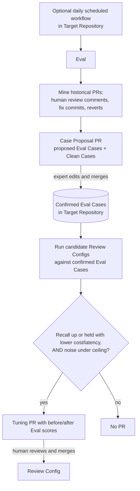

# LARP Eval - Engineering Design (first draft)

> Status: **Draft.**. Anything marked `TODO(owner)` is not decided yet and must not be treated as settled.
>
> Audience: engineers building **LARP** (primary) and teams deciding whether to adopt it.
>
> This is part 2 of 2. It covers the optional Eval. It builds on part 1, [LARP Review design](design-review.md), which defines the Review Config, Reviewers, Findings, and Severities that the Eval grades and tunes.

## Summary

An optional **Eval** grades a Target Repository's **Review Config** against expert-confirmed historical PRs. It proposes new Eval Cases through **Case Proposal PRs** and Review Config changes through **Tuning PRs**. Humans review and merge both kinds of PR, so the Eval never changes review behaviour on its own.

Domain terms are defined in [GLOSSARY.md](../GLOSSARY.md) and used here exactly as defined there.

## Goals

- Offer an opt-in Eval that measures review quality against the Target Repository's own history and proposes Review Config changes.
- Make every Eval-driven change reviewable: new Eval Cases and Review Config changes both arrive as PRs with evidence.

## Non-goals

- **Live-feedback Eval in v1**, meaning grading from reactions or thread resolution on real PRs. This is deferred to a later version.
- **Letting the Eval change the Verdict Rubric, Excluded Paths, or Sensitive Paths.**
- **Running by default.** The Eval is off until the Target Repository opts in.

## Background and prior art

- **Anthropic, "Solving code review at Anthropic"** (<https://claude.dev/blog/solving-code-review-at-anthropic/>). Anthropic runs a daily eval built from past incidents, with engineers confirming each bug, measures noise on PRs known to be clean, and puts "catch real bugs first". These points shaped the Eval objective ([ADR 0002](adr/0002-eval-objective-recall-first.md)) and expert confirmation of Eval Cases.
- **Cloudflare, "Orchestrating AI Code Review at scale"** (<https://blog.cloudflare.com/ai-code-review/>) does not describe an eval loop. Its model overrides come from a remote control plane, which LARP rules out.

## Eval loop

> TODO(owner): Decide how the Eval generates the candidate Review Configs it compares (search strategy, how many candidates per run).

## Scope and scheduling

- **Opt-in and off by default.** It runs as an optional **daily scheduled GitHub workflow** in the Target Repository.
- v1 grades against **historical PRs only**. Live feedback, such as reactions and thread resolution on real PRs, is deferred.

## Eval Cases

- An **Eval Case** is a historical PR paired with its **Expected Findings**. Expected Findings come from human review comments and from later evidence, such as follow-up fix commits and reverts.
- A **Clean Case** is a historical PR with no Expected Findings. Candidates are proposed automatically, for example PRs merged at least N days ago with no revert, fix, or flag.
- **Both kinds are proposed automatically, and neither counts until a human expert confirms it.** The expert confirms cases by editing and merging a **Case Proposal PR** that the Eval opens. Confirmed Eval Cases are stored in the Target Repository. This means the Eval cannot run without expert time.

> TODO(owner): Decide the Eval Case storage format and location, and the Case Proposal PR format.
>
> TODO(owner): Choose the starter Clean Case age N.
>
> TODO(owner): Define how the Eval matches a produced Finding to an Expected Finding when grading (location tolerance, semantic match, who or what judges).

## Objective

Defined in [ADR 0002](adr/0002-eval-objective-recall-first.md):

1. **Recall** of Expected Findings is the objective.
2. **Noise**, meaning Findings on Clean Cases, has a **hard ceiling** set in the Review Config.
3. **Cost and latency** only break ties.

LARP does not use precision over all Eval Cases. Historical PRs contain real bugs that nobody caught, and those would be scored as false positives, which would push tuning toward missing bugs.

> TODO(owner): Choose the starter noise ceiling and its unit (e.g. Findings per Clean Case, or share of Clean Cases with any Finding).

## Tuning PRs

- The Eval opens a **Tuning PR** only if recall improves, or holds while cost or latency falls, **and** noise stays under the ceiling.
- A Tuning PR **may** change: tier thresholds, effort levels, Reviewer counts per tier, model choices, and Reviewer prompts.
- A Tuning PR **may not** change: Excluded Paths, Sensitive Paths, or the Verdict Rubric.
- Each Tuning PR should include **before and after Eval scores**.
- A Tuning PR is reviewed and merged by humans like any other change to the Review Config.

> TODO(owner): Decide whether a Tuning PR must itself be gated by an Eval run (e.g. a required check), beyond the scores the Eval reports.

## Eval cost and credentials

> TODO(owner): Decide how mining historical PRs handles credentials and rate or cost limits, and set the Eval cost budget.

## Security and credentials

- The Eval runs as a scheduled workflow in the Target Repository and uses the same secret-name references as reviews (see [LARP Review design](design-review.md#security-and-credentials)).
- Case Proposal PRs and Tuning PRs are ordinary PRs. They go through the same branch protection and CODEOWNERS rules as any other change, including CODEOWNERS on the Review Config.

## Risks

- **Expert time for the Eval.** No Eval Case counts without expert confirmation. If experts are not available, the Eval set will stay small and Tuning PRs will be poorly grounded.
- **Recall bias in the Eval set.** Expected Findings come from issues people actually noticed, through human review comments, fixes, and reverts. Kinds of bugs that people miss are under-represented.

## Decisions

| Decision | Record |
|---|---|
| Eval objective is recall first, with a noise ceiling measured on Clean Cases; cost and latency break ties; Tuning PR scope is limited | [ADR 0002](adr/0002-eval-objective-recall-first.md) |

## Open questions

1. Case Proposal PR and Eval Case storage format and location.
2. Starter noise ceiling (and its unit) and Clean Case age N.
3. How mining historical PRs for the Eval handles credentials and cost limits; Eval cost budget.
4. Whether a Tuning PR must itself be gated by an Eval run.
5. How Findings are matched to Expected Findings.
6. How Eval candidates are generated.
