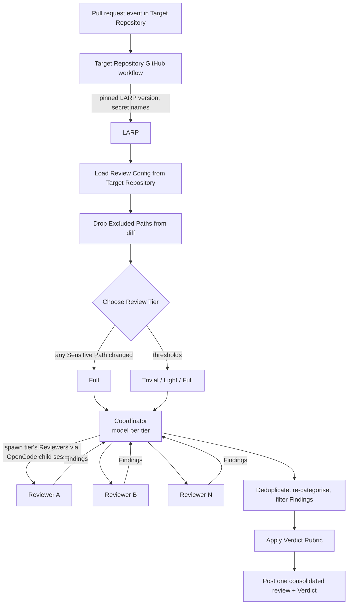

# LARP Review - Engineering Design (first draft)

> Status: **Draft.**. Anything marked `TODO(owner)` is not decided yet and must not be treated as settled.
>
> Audience: engineers building **LARP** (primary) and teams deciding whether to adopt it.
>
> This is part 1 of 2. It covers reviewing pull requests. Part 2, [LARP Eval design](design-eval.md), covers the optional Eval that grades and tunes the Review Config.

## Summary

**LARP** (the Landscape Agentic Review Pipeline) is an agentic code-review package. A **Target Repository** calls it from its GitHub workflows when a pull request is opened. LARP runs on the open-source OpenCode harness. A **Coordinator** agent picks the **Reviewers** for the PR's **Review Tier** and runs them. It then combines their **Findings** into one review with a **Verdict**, and that Verdict can block the merge.

All review behavior comes from the **Review Config**, which lives in the Target Repository. LARP has no runtime defaults. The Review Config can be tuned by humans directly, or by Tuning PRs from the optional Eval ([LARP Eval design](design-eval.md)).

Domain terms are defined in [GLOSSARY.md](../GLOSSARY.md) and used here exactly as defined there.

## Goals

- Review pull requests in GitHub, triggered from the Target Repository's GitHub workflows.
- Take all review behaviour from the Target Repository: models, effort levels, Reviewers and their responsibilities, how many Reviewers run per Review Tier, tier thresholds, Excluded and Sensitive Paths, Severities, the Verdict Rubric, Verdict permissions, and Eval settings. Credentials are included as references to secret names.
- Assign every PR a Review Tier (**Trivial**, **Light**, or **Full**) from the number of files and lines changed, using thresholds the Target Repository defines.
- Produce one consolidated review per run, with a Verdict that can gate merging.
- Change review behaviour only through PRs in the Target Repository, so behaviour can be audited and Eval results can be compared over time.

## Non-goals

- **Runtime defaults in LARP.** LARP never supplies missing configuration ([ADR 0001](adr/0001-no-runtime-defaults.md)).
- **A remote control plane** for model overrides or config. Configuration comes only from the Target Repository.
- **Automatic Re-review on push.** Re-review happens only when a human asks for it ([ADR 0003](adr/0003-gating-verdicts-on-demand-re-review.md)).
- **Agent approvals that replace a required human approval** by default. Approving is opt-in, and the scaffold is block-only.
- **A "break glass" override command.** Overrides use GitHub's existing admin bypass.
- **PRs from forks.** See [Security and credentials](#security-and-credentials).

## Background and prior art

- **Cloudflare, "Orchestrating AI Code Review at scale"** (<https://blog.cloudflare.com/ai-code-review/>). Built on OpenCode. A coordinator agent runs specialist reviewers, PRs are sorted into size-based tiers, noise is filtered, a Severity rubric drives the outcome, and later pushes are re-reviewed against earlier findings. LARP follows this model for the Coordinator/Reviewer split, tiering, Excluded Paths, the scaffolded Verdict Rubric, and how Re-review handles previous Findings. Where LARP differs:
  - Cloudflare uses a remote control plane for model overrides. LARP does not, because all configuration must come from the Target Repository.
  - Cloudflare re-reviews on every push. LARP re-reviews only on request ([ADR 0003](adr/0003-gating-verdicts-on-demand-re-review.md)).
  - Cloudflare does not describe an eval loop. LARP has one.
- **Anthropic, "Solving code review at Anthropic"** (<https://claude.dev/blog/solving-code-review-at-anthropic/>). Anthropic reports that agent-author/agent-reviewer loops ran for 50+ rounds, and advises that an agent's approval should not replace a required human approval. These points shaped on-demand Re-review ([ADR 0003](adr/0003-gating-verdicts-on-demand-re-review.md)) and opt-in approvals. Its influence on the Eval is covered in [LARP Eval design](design-eval.md).

## Glossary

See [GLOSSARY.md](../GLOSSARY.md). This document uses those terms exactly. For example, it says **Reviewer**, never "subagent", and **Review Tier**, never "risk tier".

## Architecture overview

LARP is a versioned package that the Target Repository's workflows call. LARP pins an exact OpenCode version. The Target Repository pins an exact LARP version. OpenCode was chosen for two reasons:

1. We wanted to use an open-source harness.
2. OpenCode's server-first SDK can programmatically start concurrent child sessions, which the Coordinator needs in order to run Reviewers in parallel.

### Review flow

## Review flow

1. A pull request event in the Target Repository triggers a workflow that calls the pinned LARP version. The workflow passes references to secret names, never the key values.
   > TODO(owner): List which pull request events trigger a first review (opened, ready_for_review, etc.).
2. LARP loads the Review Config from the PR's **base branch**, never from the PR itself. A PR that edits the Review Config is reviewed under the config it is changing, and its edits take effect only after it merges.
   - If the Review Config is missing or invalid, the run **fails open**. LARP posts a non-blocking comment on the PR explaining the failure, and human review takes over. There are no runtime defaults to fall back on ([ADR 0001](adr/0001-no-runtime-defaults.md)).
3. LARP removes Excluded Paths from the diff, then chooses the Review Tier (see [Tiering](#tiering)).
4. The **Coordinator** runs. It runs on every tier, and the Review Config can give it a different model per tier (for example, a cheaper model on Trivial). It starts the Reviewers that the Review Config assigns to that tier.
5. Each **Reviewer** has one responsibility. Its prompt, model, and effort level come from the Review Config. It sees the diff without Excluded Paths and returns Findings, each with a Severity.
6. The Coordinator removes duplicate Findings, re-categorises them, and filters them. It then applies the Verdict Rubric and posts **one** consolidated review containing the Verdict.
   > TODO(owner): Define the filtering criteria the Coordinator applies (e.g. confidence, relevance to changed lines) and whether they are configurable in the Review Config.

## Review Config

### Contents

The Review Config is the complete definition of how reviews run for a Target Repository. It contains:

- Models and effort levels, including the Coordinator's model per Review Tier.
- Reviewers: each one's responsibility, prompt, model, and effort.
- How many Reviewers run per Review Tier, and which ones.
- Review Tier thresholds (files changed, lines changed).
- Excluded Paths and Sensitive Paths.
- Severities (critical, warning, suggestion) and the Verdict Rubric.
- Verdict permissions: the **blocking mode** (blocking or advisory) and the approve opt-in.
- Eval settings, including the noise ceiling (see [LARP Eval design](design-eval.md)).
- Credential references, as secret names (e.g. `secrets.ANTHROPIC_API_KEY`).

> TODO(owner): Decide the Review Config file format, location in the Target Repository, and schema.

### Ownership and scaffolding

- LARP has **no runtime defaults** ([ADR 0001](adr/0001-no-runtime-defaults.md)).
- A **scaffold command** copies a starter Review Config into the Target Repository once. After that, the Target Repository owns it. Improvements to the starter config do not reach repositories that have already scaffolded.
- The scaffold is block-only (approving has to be turned on explicitly) and **advisory**: blocking mode has to be turned on explicitly too, after the GitHub settings below are in place. A newly onboarded repository never has merges blocked by LARP until it opts in.

> TODO(owner): Define the scaffold command's name, invocation, and the full contents of the starter Review Config, including the starter Reviewer roster.

### Version pinning

- LARP pins an exact OpenCode version.
- The Target Repository pins an exact LARP version.
- Review behaviour changes only through a PR in the Target Repository. That can be a Review Config edit, a Tuning PR (see [LARP Eval design](design-eval.md)), or a bump of the pinned LARP version.

## Tiering

- Three **Review Tiers**: **Trivial**, **Light**, **Full**.
- Two signals: files changed and lines changed, both counted after Excluded Paths are removed. Each signal maps to a tier, and **the higher of the two wins**.
- Thresholds are set in the Review Config.
- **Excluded Paths** are file patterns that are neither counted for tiering nor shown to Reviewers. Examples are lockfiles, generated code, and minified assets. This follows Cloudflare's approach.
- **Sensitive Paths** are directories where any change forces **Full**, whatever the size of the PR.
- If a path matches both lists, **Excluded wins**.
- The Review Config defines which Reviewers run on each tier, and how many.

> TODO(owner): Decide the starter thresholds. **Proposed, not decided** (from Cloudflare): Trivial if ≤10 lines and ≤20 files; Light if ≤100 lines and ≤20 files; otherwise Full; >50 files always Full.
>
> TODO(owner): Decide the starter Reviewer roster per tier.
>
> TODO(owner): Decide how "lines changed" is counted (additions + deletions, or additions only).

## Findings, Verdicts, and gating

### Findings

Each **Finding** has a **Severity**: **critical**, **warning**, or **suggestion**.

> TODO(owner): Define the fields of a Finding (location, rationale, suggested fix, etc.) and how each is rendered in the posted review.

### Verdict Rubric

The **Verdict Rubric** lives in the Review Config. It maps the set of Findings, by Severity, to a **Verdict**. Only humans change it.

The scaffolded rubric:

| Findings | Verdict |
|---|---|
| None, or only suggestions | Approve (with comments) |
| Some warnings, no production risk | Approve with comments |
| Multiple warnings suggesting a risk pattern | Minor issues: no approval, and LARP revokes its own earlier approval |
| Any critical | Block (request changes) |

> TODO(owner): Decide what LARP posts for the "approve" rows when the Target Repository has not opted in to approving (the scaffold is block-only).
>
> TODO(owner): Define how "production risk" and "risk pattern" are judged, and by which agent (Coordinator or Reviewers).

### Gating and overrides

- The Review Config's **blocking mode** decides whether a Verdict can block merging. GitHub has no setting specifically for bot reviews, so the choice lives in the repository where it is versioned and covered by CODEOWNERS.
  - **Blocking:** a block Verdict is submitted as a **"request changes" review**.
  - **Advisory:** the same Verdict is posted as a comment and never blocks.
- To make blocking mode effective, the Target Repository must configure branch protection or rulesets on important branches (e.g. `main`):
  - **Require pull request reviews before merging.** Without this, a "request changes" review does not block.
  - **Restrict who can dismiss pull request reviews.** By default, anyone with write access, including the PR author, can dismiss LARP's blocking review.
- Overrides use GitHub's existing admin bypass. There is no "break glass" command.
- Approving is **opt-in** per Target Repository. It also requires the GitHub repository setting "Allow GitHub Actions to create and approve pull requests". An agent's approval should not replace a required human approval.

GitHub treats a "request changes" review as blocking only when required-review rules are enabled **and** the reviewer's token has sufficient repository access. So the workflow's token needs write access to pull requests, and onboarding should include a check: open a test PR, let LARP block it, and confirm that GitHub reports "Changes have been requested" as the unmet requirement when someone tries to merge.

### Stale Verdicts

Any push to a PR makes its current Verdict a **Stale Verdict** ([ADR 0003](adr/0003-gating-verdicts-on-demand-re-review.md)):

- A stale block **keeps blocking**.
- A stale approval **stops counting**.
- Only a Re-review replaces a Stale Verdict.

As a result, an author who fixes a blocking Finding must also request a Re-review before the PR can merge.

Both behaviours come from GitHub. A "request changes" review stays in force across pushes. Repositories that opt in to approving must enable "Dismiss stale pull request approvals when new commits are pushed", which makes a stale approval stop counting.

## Re-review

- **On demand only.** A human requests it. Pushes never trigger it automatically. The reason is to avoid runaway agent-author/agent-reviewer loops (Anthropic reported 50+ rounds on one PR) ([ADR 0003](adr/0003-gating-verdicts-on-demand-re-review.md)).
- The Review Tier is **recalculated on the whole PR's current diff**.
- The Re-review receives the **previous Findings**:
  - A Finding that has been fixed has its thread resolved automatically.
  - A Finding that has not been fixed is emitted again.
  - A thread a human resolved stays resolved, unless the issue has materially worsened.
- The Re-review issues a new Verdict, which replaces the Stale Verdict.

> TODO(owner): Decide the Re-review trigger mechanism (comment command, label, workflow_dispatch, etc.) and who may trigger it.
>
> TODO(owner): Define "materially worsened" and which agent decides it.

## Security and credentials

- The Review Config refers to **GitHub secret names** (e.g. `secrets.ANTHROPIC_API_KEY`). Keys are never stored in the repository.
- Approving needs the Target Repository's "Allow GitHub Actions to create and approve pull requests" setting. Repositories that stay block-only do not need it.
- Verdicts can be overridden only through GitHub's admin bypass.

> TODO(owner): Decide how LARP handles prompt injection in content the PR author controls (diff, PR title and description, code comments, and the Review Config itself when the PR changes it). Not discussed yet; see Risks.
>
> TODO(owner): Decide the full set of GitHub token permissions the workflow needs (at minimum, write access to pull requests so blocking reviews count).

- **PRs from forks are not supported.** GitHub does not give secrets to workflows triggered by fork PRs, so LARP cannot call models for them. Contributors to a Target Repository should open PRs from branches in that repository. Supporting forks is possible, but this design does not cover it.

## Risks

- **Prompt injection from PR content.** Reviewers and the Coordinator read content the PR author controls. A crafted diff could suppress Findings or change the Verdict. Not addressed yet.
- **PRs that change the workflow file.** The Review Config is read from the base branch, but on `pull_request` events GitHub runs the workflow file as it appears in the PR. A PR could change the pinned LARP version or delete the review step, and a review that never runs never blocks. **Mitigation:** the Target Repository assigns CODEOWNERS to `.github/workflows/`, the Review Config, and `CODEOWNERS` itself, and enables "Require review from Code Owners". Changes to how review runs then need a code owner's approval.
- **Failing open.** A missing or invalid Review Config produces a non-blocking comment, not a block, so these PRs rely entirely on human review.
- **Resilience.** Timeouts, model failback, and behaviour when a provider is down are not defined. Cloudflare uses circuit breakers and failback chains. Because Verdicts gate merges, a failed run could block or unblock PRs unexpectedly.
  > TODO(owner): Define timeouts, failback, and what Verdict (if any) is posted when a run fails.
- **Author friction from Stale Verdicts.** Every fix to a blocked PR needs a manual Re-review request, which may annoy authors. This trade-off was accepted in [ADR 0003](adr/0003-gating-verdicts-on-demand-re-review.md).
- **Starter config drift.** Because there are no runtime defaults, improvements to the starter config never reach existing Target Repositories ([ADR 0001](adr/0001-no-runtime-defaults.md)).

## Decisions

| Decision | Record |
|---|---|
| No runtime defaults; the Review Config lives entirely in the Target Repository; scaffold once; exact version pinning | [ADR 0001](adr/0001-no-runtime-defaults.md) |
| Verdicts gate merges; pushes make Verdicts stale; Re-review is on demand only | [ADR 0003](adr/0003-gating-verdicts-on-demand-re-review.md) |
| OpenCode as the harness (open source; server-first SDK supports concurrent child sessions) | No decision record. > TODO(owner): decide whether this needs one. |
| Excluded Path takes precedence over Sensitive Path | No decision record (easy to reverse). |

## Open questions

1. Re-review trigger mechanism, and who may trigger it.
2. Review Config file format, location, and schema.
3. Starter tier thresholds (Cloudflare's numbers proposed, not decided) and starter Reviewer roster.
4. Timeouts, model failback, and resilience behaviour, including what Verdict a failed run produces.
5. Prompt-injection handling for content the PR controls.
6. Items raised while drafting (see the inline TODOs): what "approve" rows post when approving is off; Finding fields; Coordinator filtering criteria; full token permissions.
